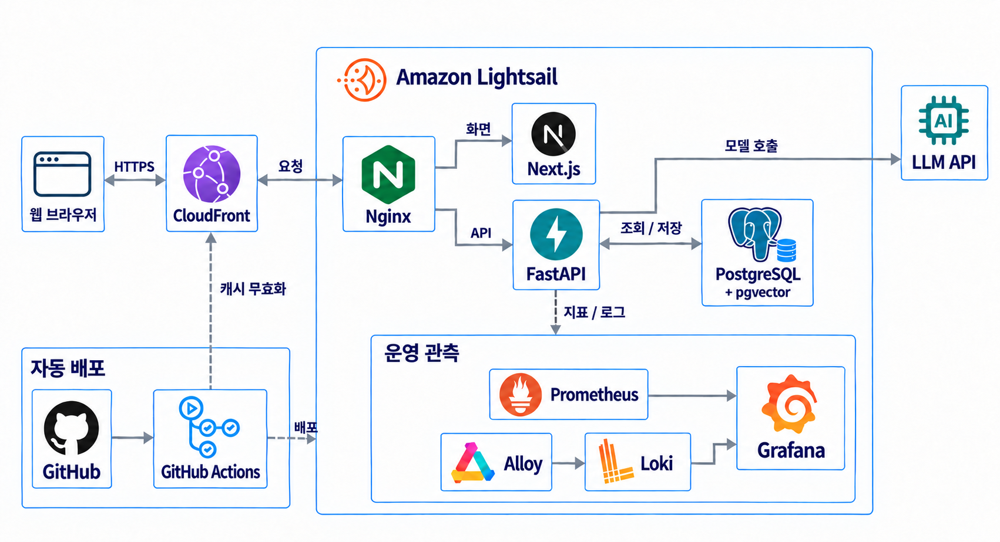
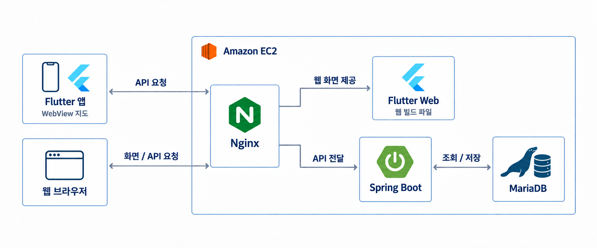
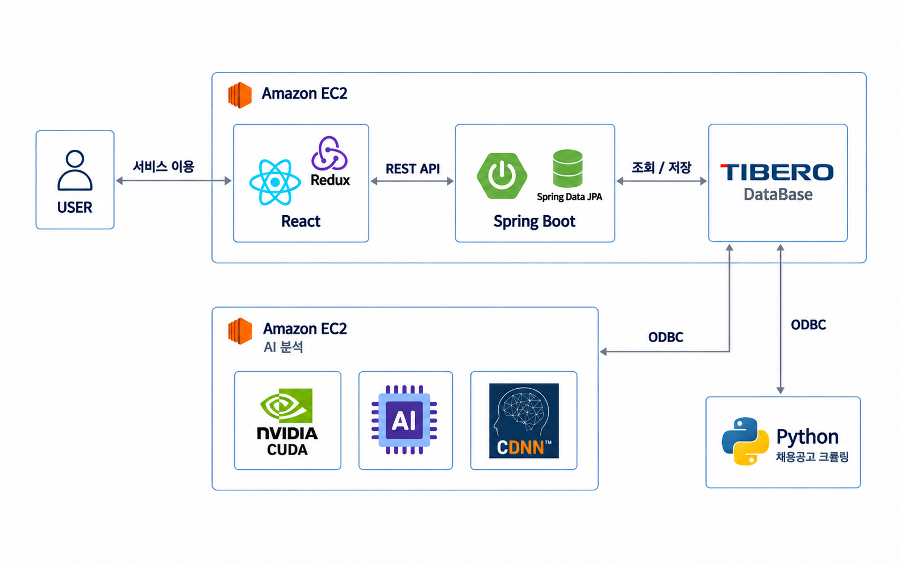

# 강현준 포트폴리오

[포트폴리오 웹사이트](https://unfl1.github.io/portfolio/) · [GitHub](https://github.com/unfl1)

| 프로젝트 | 담당 역할 | 주요 개발 내용 |
| --- | --- | --- |
| [PokeSettle](#pokesettle) | 프론트엔드, 백엔드, RAG, 인프라 구성과 운영 | 근거 기반 전략 챗봇, 도감 검색, 전투 시나리오 분석, 서비스 배포와 운영 |
| [Jiki](#jiki) | 백엔드 개발 및 팀장 | 약속 참여 관리, 접근 권한 검증, 벌금과 보상 정산 |
| [다잡아](#다잡아) | 프론트엔드 개발 | 채용공고 탐색, 자기소개서 관리, 매칭 결과 시각화 |

## PokeSettle

**문서 근거와 전투 계산을 연결한 포켓몬 전략 챗봇**

포켓몬 전략 질문에 관련 자료와 계산 결과를 바탕으로 답변하고, 도감 탐색과 팀 구성별 전투 분석을 제공하는 서비스입니다.

- **담당 역할**: 프론트엔드, 백엔드, RAG, 인프라 구성과 운영
- **기술**: Next.js, TypeScript, Tailwind CSS, FastAPI, LangGraph, PostgreSQL(pgvector), Docker, AWS
- **서비스**: [PokeSettle](https://www.pokesettle.com/)
- **저장소**: [GitHub](https://github.com/unfl1/pokesettle)

### 시스템 구조

### 핵심 기능

- **근거 기반 챗봇**: 문서 검색과 전투 계산을 연결한 전략 답변, 실제 인용 자료 확인, 대화별 전투 상태와 기록 복원
- **도감과 자연어 탐색**: 총 1,351개 항목의 타입, 종족값, 특성, 기술 조회와 조건 검색
- **전투 시나리오 분석**: 양쪽 팀 구성, 6대6에서 3마리를 선출하는 20개 조합 비교, 타입 상성을 바탕으로 공격·교체 분석
- **메타 순위**: 시즌별 사용 순위와 기술, 특성, 도구 세팅 조회
- **다국어 화면**: 한국어, 영어, 일본어, 중국어 경로와 페이지별 검색 메타데이터 제공
- **배포와 운영**: Docker와 AWS 기반 서비스 운영, GitHub Actions 자동 배포, Grafana 운영 관측

 

## Jiki

**약속 참여 여부와 도착 상태에 따른 벌금과 보상 정산 서비스**

약속을 생성하고 참여자를 초대하며, 참여 여부와 도착 상태를 기준으로 벌금과 보상을 정산하는 서비스입니다.

- **담당 역할**: 백엔드 개발, 팀장
- **기술**: Java, Spring Boot, Spring Data JPA, Spring Security, MariaDB
- **저장소**: [GitHub](https://github.com/CapstoneDesign-timeisgold/Back)

### 시스템 구조

### 핵심 기능

- **약속 관리**: 약속 생성과 조회, 참여자 초대, 초대 수락과 거절, 참여 취소
- **참여 상태 관리**: 참여 마감 설정, 도착 상태 관리, 참여자별 접근 권한 검증
- **정산**: 벌금과 보상 계산, 내부 잔액 반영, 정산 결과와 거래 내역 조회
- **인증과 친구 관리**: JWT 인증, 친구 요청과 수락·거절, 친구 목록 조회

 

## 다잡아

**AI로 자기소개서를 분석해 크롤링으로 수집한 채용공고와 매칭하는 서비스**

사용자가 자기소개서를 작성하고, 분석 결과를 바탕으로 자신에게 맞는 채용공고를 탐색할 수 있는 서비스입니다.

- **담당 역할**: 프론트엔드 개발
- **기술**: JavaScript, React, Redux Toolkit, React Redux, Redux Persist, Tailwind CSS
- **저장소**: [GitHub](https://github.com/TABA-DaJobA/Front)

### 시스템 구조

### 핵심 기능

- **채용공고 탐색**: 직군별 필터, 서버 페이지네이션 연동, 공고 상세 조회
- **자기소개서 관리**: 작성, 조회, 수정, 삭제, 글자 수 표시, 사용자별 초안 자동 저장과 복원
- **매칭 결과 확인**: 기업별 매칭 점수와 순위 시각화, 추천 공고 연결
- **분석 대기 안내**: 분석 중 스피너 표시와 결과 화면 전환
